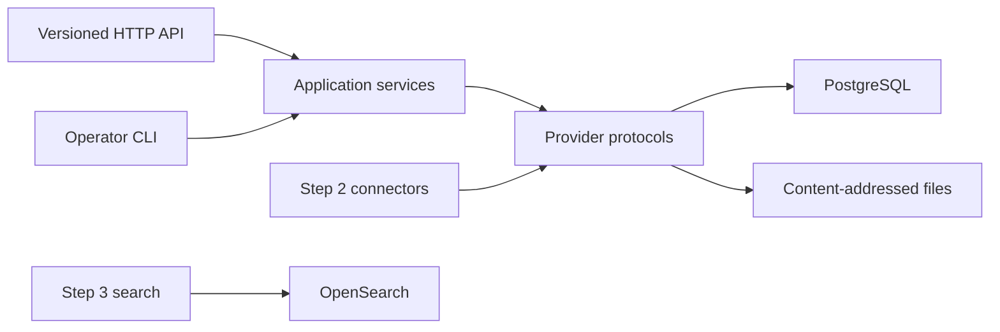

# Step 1 foundation

## Outcome

Step 1 establishes a local, provider-oriented platform on which acquisition and
search can be added without changing evidence identity or provenance semantics.
Its acceptance slice sends one deterministic macro-policy fixture through
content-addressed storage, canonical persistence, the HTTP API, a durable job,
and a checksum-addressed evidence-pack export.

The initial implementation targets one 48 GiB Apple Silicon Mac. AWS adapters
are intentionally deferred, while infrastructure dependencies remain behind
ports so an AWS profile can be implemented without importing AWS concepts into
the domain.

## Resolved discovery decisions

| Decision | Pilot contract |
| --- | --- |
| Subject boundary | Macroeconomics, monetary policy, and Federal Reserve System research and policy documents. |
| Users | Academic economists, policy economists, and research assistants. |
| Representative work | General research and literature review plus estimate comparison, historical reconstruction, research-to-policy tracing, RA review, and bounded agent retrieval. |
| Initial source families | RePEc metadata, Crossref, CORE, Boston Fed Research, and Federal Reserve Board/FOMC. |
| Local reference host | 48 GiB Apple Silicon MacBook Pro; reserve at least 8 GiB for the operating system and interactive work. |
| Runtime restriction | No proprietary runtime is required. Podman, PostgreSQL, OpenSearch, Python, and all Python runtime dependencies are open source. |
| Historical mode | Strict eligibility is applied before candidate generation; unknown availability and uncertified learned signals are excluded. |
| Benchmark | Sixty stratified tasks with grouped development, validation, and held-out test splits. |

These choices do not constitute an institutional rights determination. Every
real source remains disabled and default-deny in the source registry until its
metadata and content actions have been reviewed.

## Architecture boundary

The domain package contains immutable values and state transitions. Application
services implement use cases. Provider packages own SQL and filesystem details.
The API and CLI call application services and never issue direct storage calls.

OpenSearch is present in the complete local composition to fix the portability
boundary, but it is not on the Step 1 request path. Search mappings and query
behavior belong to Step 3.

## Canonical identity and lineage

Opaque identifiers are deterministic UUIDv5 values with type prefixes. Their
inputs are semantic identity components, never database sequence values:

| Prefix | Identity basis |
| --- | --- |
| `src` | Stable source registry code. |
| `wrk` | Approved source namespace and persistent external identifier. |
| `ver` | Work identifier and exact raw-content digest. |
| `man` | Source, source identifier, and exact content digest. |
| `ext` | Version, parser identity, parser version, and normalized-text digest. |
| `evu` | Extraction artifact, ordinal, and passage digest. |
| `evr` | Version, record type, and record-local semantic key. |
| `snp` | Canonical snapshot-manifest digest. |

Raw and exported bytes use SHA-256 content addresses. Repeating an ingest or an
export is idempotent; presenting different bytes or metadata under an existing
immutable identifier is a conflict.

The platform aggregate requires this complete path:

`source policy -> retrieval event -> raw asset -> document version -> extraction artifact -> evidence unit -> evidence field anchor -> corpus snapshot`

## Pilot evidence schema

The exchange contract is `eeg.macro-evidence.v1`. Its initial record types are:

- `empirical_estimate`
- `qualitative_finding`
- `policy_statement`
- `forecast_projection`
- `descriptive_statistic`

Every field revision carries its observed display value, normalized scalar,
units, applicability, review state, lineage method, confidence, and at least one
exact evidence anchor. An anchor identifies an evidence unit and includes both a
structural/page locator and the supporting source excerpt.

Estimate records should represent, when reported, the estimand or outcome,
treatment or comparison, point estimate, uncertainty, units, horizon, sample,
geography or population, data and vintage, identification strategy,
specification, and caveats. Applicability belongs to each field because a value
without its specification or sample is not reusable evidence.

The JSON exchange schema is versioned at
`config/schemas/evidence-record-v1.schema.json`; the same invariants are enforced
by immutable Python domain objects and relational constraints.

## Strict historical precedence

For an as-of cutoff, eligibility is calculated before lexical, vector, graph, or
reranking channels execute. Date evidence is considered in this order:

1. Verified direct observation by this system.
2. Approved upstream observation with preserved evidence.
3. Official release timestamp with preserved evidence.
4. An asserted publication or revision date.

An asserted date is not silently promoted to an observed-public date. Unknown or
ambiguous availability is surfaced and excluded in strict mode. T0 source facts
and T1 deterministic transformations are eligible; T2 learned artifacts are
excluded unless separately certified for the artifact version and cutoff range;
T3 later annotations and synthesis are excluded.

## Benchmark protocol

The sixty-task plan is intentionally fixed before ranking work:

| Stratum | Tasks |
| --- | ---: |
| General research and literature review | 15 |
| Compare economic estimates | 12 |
| Historical reconstruction | 12 |
| Trace research into policy | 10 |
| RA review and handoff | 6 |
| Agent retrieval and abstention | 5 |

Tasks balance inflation and expectations, labor markets, policy transmission,
financial conditions and stability, and current conditions and forecasts. Every
task captures relevant works, exact evidence, hard negatives, duplicate/version
cases, cutoff decisions, relationship labels, valid abstention behavior,
annotation status, and retained dissent. Question and work families cannot cross
data splits, reducing benchmark leakage.

## Local resource envelope

The checked-in profile serializes heavy pipeline work, uses one interactive API
worker, limits source concurrency to one request per host, gives OpenSearch a 2
GiB heap, and reserves 8 GiB of host memory. The mandatory capacity acceptance
fixture is 1,000 document versions and 50,000 evidence units. A ceiling of
10,000 versions and 500,000 units is conditional on measured memory, disk,
throughput, and thermal behavior.

## Step 1 acceptance and deferred work

The synthetic fixture is conspicuously marked as non-research content and uses
the public-domain CC0 dedication. The acceptance test proves stable identifiers,
exact evidence anchors, relational and artifact health, idempotent job state,
API error contracts, export checksums, and snapshot/source-policy lineage.

Step 2 owns rights-policy evaluation, network connectors, parsing/OCR routing,
quarantine, and identity candidates. Step 3 owns OpenSearch mappings, hybrid
retrieval, historical query planning, ranking, and the first research UI. No
real-source acquisition is authorized by the Step 1 implementation.
