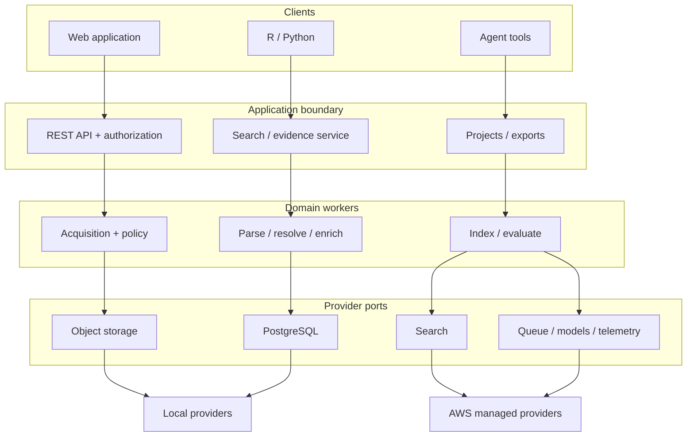
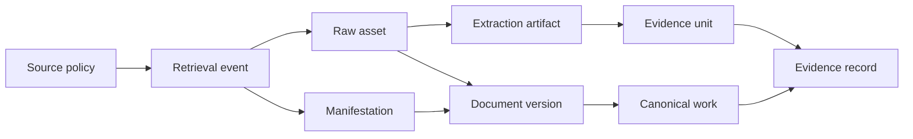

# Economic Evidence Graph

<!-- cspell:words ASGI baselined estimand idempotently lockfiles missingness Ollama partitionable pgvector rcfg rerank reranker reranking sandboxed SRCH uncited unreviewed -->

Technical Design Document

V1 implementation design for versioned, auditable economic evidence infrastructure

**Status:** Steps 1-5 local implementation baseline; AWS and institutional acceptance remain deferred

**Version:** 0.5

**Date:** August 6, 2026

**Specification alignment:** Economic Evidence Graph Product and System Specification v0.3, with PORT-06 superseded by the two-profile deployment decision

**Primary users:** Academic economists, policy economists, and research assistants

**Deployment:** Local with AWS parity on 48 GB Apple Silicon, and AWS

**Audience:** Research Data and Technology Solutions and research stakeholders

> **Design status:** This document is aligned with System Specification v0.3 except for PORT-06, whose optional PostgreSQL-only search mode is superseded by the decision to support exactly two deployment profiles. Steps 1 through 5 implement the local platform, governed corpus, hybrid search, strict historical retrieval, collaborative evidence workflows, clients, agent tools, local readiness, and promotion contracts. Enterprise identity, learned-model approval, retention, recovery objectives, production source-rights review, stakeholder benchmark thresholds, named operational acceptance, and AWS implementation remain institutional decisions rather than approved facts.

Reviewers should use Sections 3-12 to assess technical feasibility, Section 14 to resolve design-blocking decisions, and Appendix A to verify coverage of every specification requirement.

## 1. Executive summary

This design implements Economic Evidence Graph v1 as a portable, evidence-first research system. It preserves approved public-source material and its acquisition history; resolves intellectual works separately from document versions and source manifestations; extracts section- and page-anchored evidence; represents economics-specific findings and estimates; and exposes the resulting corpus through a web application, REST API, R and Python clients, and typed agent tools.

The v1 implementation is a modular application with independently executable API, scheduler, and worker processes. PostgreSQL is the system of record and citation-adjacency store. Single-node OpenSearch provides local hybrid retrieval, while Amazon OpenSearch Service provides AWS retrieval behind the same SearchIndex contract and versioned mappings. Immutable source and derived artifacts live behind an object-store interface. Provider ports isolate storage, search, queue, identity, model, and telemetry choices so the same domain code operates locally and on AWS.

> **Key design decision:** Historical-cutoff searches filter the eligible information set before retrieval and ranking. The default strict mode permits direct source facts and deterministic transformations of cutoff-eligible content, but excludes later human annotations, later document versions, and learned or generated signals that have not been certified as cutoff-safe.

The design intentionally avoids a dedicated graph database, autonomous policy recommendation, and a chat-first product. Those choices can be reconsidered only after measured workloads or user outcomes justify the additional complexity.

## 2. Scope, constraints, and design decisions

### 2.1 Design goals

- Make every returned passage, estimate, relationship, and generated comparison resolvable to an exact document version, source locator, retrieval event, and processing lineage.

- Support the three signature workflows: compare economic estimates, reconstruct historical evidence, and trace research into policy.

- Keep retrieval useful without generation and make every model-assisted value reviewable, reversible, and explicitly non-authoritative until approved.

- Run the complete logical product locally on a 48 GB Apple Silicon Mac and promote the same canonical artifacts and identifiers to AWS.

- Enforce source-specific acquisition, storage, embedding, display, export, and redistribution policy at both ingestion and delivery time.

- Provide stable, typed interfaces for web, R, Python, and bounded agent use while preventing project data from leaking into global retrieval.

### 2.2 Constraints and assumptions

| **Constraint** | **Design response** |
| ---- | ---- |
| Public-source corpus; internal workflow data | Corpus evidence and project data use separate authorization and indexing paths. Project notes, queries, and feedback never enter global ranking by default. |
| Source rights vary | A versioned policy matrix determines behavior per source and content class; unspecified actions deny by default. |
| 48 GB local reference host | A resource governor serializes OCR, embedding, index rebuild, and local generation; normal operation reserves at least 8 GB for the operating system. |
| AWS production target | AWS services implement provider interfaces rather than appearing in domain logic; production-only identity, encryption, network, audit, and recovery controls are tested separately. |
| Macro/FRS pilot with five source families | Versioned configuration selects RePEc metadata, Crossref, CORE, Boston Fed, and Board/FOMC. The evidence model remains extensible across macroeconomic topics. |
| Historical reconstruction | Availability and processing lineage are first-class data. Strict as-of execution records eligibility decisions and rejects unsafe ranking features. |

### 2.3 Non-goals and deferred decisions

- No autonomous policy advice, publication-ready review, or unreviewed causal interpretation.

- No attempt to recreate a comprehensive global scholarly index or general citation-map product.

- No graph database in v1; typed PostgreSQL adjacency tables and bounded recursive queries are the baseline.

- No required AWS emulator for local operation and no claim that local security controls equal production controls.

- No single mandatory LLM, embedding model, parser, or infrastructure-as-code tool before organizational approval and benchmark results.

### 2.4 Architecture decision record summary

| **ADR** | **Decision** | **Rationale** |
| ---- | ---- | ---- |
| ADR-001 | Modular application plus independent workers | Preserves clear boundaries and scale paths without microservice operational overhead during v1. |
| ADR-002 | PostgreSQL is the canonical system of record | Strong relational integrity, audit transactions, JSON support, vector option, and portable Aurora path. |
| ADR-003 | OpenSearch for local and AWS search | Provides lexical, faceted, vector, and hybrid retrieval with compatible local and managed deployments. |
| ADR-004 | Immutable artifacts and append-only lineage | Enables replay, reprocessing, source-policy auditing, and non-destructive corrections. |
| ADR-005 | Pre-ranking temporal eligibility | Prevents later content or derived signals from affecting candidate generation or ranking. |
| ADR-006 | Relational graph first | Citation and policy-link workloads can be measured before adding a graph store. |
| ADR-007 | Retrieval and generation are separate | R/Python and agents can consume evidence without an LLM; synthesis failures cannot hide retrieval results. |
| ADR-008 | Provider ports for infrastructure and models | The same domain contracts run on a laptop and AWS and permit future substitution. |
| ADR-009 | Model suggestions are append-only review states | Human corrections never erase observed or suggested values and remain reproducible. |
| ADR-010 | Snapshot manifests are the promotion unit | Local-to-AWS transfer preserves identifiers, policies, artifacts, and evaluation evidence. |

## 3. Architecture

### 3.1 System context

Economists and RAs interact through a browser, R, Python, or an approved agent. All interfaces call the same application API and authorization layer. The application reads canonical metadata from PostgreSQL, retrieves candidates from the active search provider, resolves exact evidence from versioned artifacts, and validates provenance before returning results. Corpus operators use the same control plane for sources, reprocessing, quality review, and suppression.



*Figure 1. Logical architecture and provider substitution boundary.*

### 3.2 Runtime units

| **Runtime** | **Responsibilities** | **Scale and failure boundary** |
| ---- | ---- | ---- |
| web-api | REST API, browser backend, authentication, authorization, project operations, provenance validation, job submission. | Stateless replicas; no long-running parsing or model inference in request threads. |
| search-service | Query parsing, eligibility plan, candidate fusion, reranking, evidence selection, ranking explanations. | May initially share the web-api deployment but retains an internal interface and independent performance metrics. |
| scheduler-relay | Source schedules, transactional-outbox relay, bounded request budgets, job dispatch. | Singleton per schedule partition; all operations use leases and idempotency keys. |
| corpus-worker | Acquisition, parsing, OCR routing, reference extraction, normalization, identity resolution, enrichment, embeddings, indexing. | Job-type concurrency limits; at-least-once delivery with idempotent effects and quarantine. |
| export-worker | Large project exports, Parquet generation, snapshot packaging, expiry and checksum publication. | Separate queue and storage budget so exports cannot starve ingestion or search. |
| agent-tool-adapter | Typed tool schemas mapped to REST operations; bounds, error translation, structured citations. | No independent corpus access and no ability to bypass API authorization. |
| web-ui | Search, work record, reader, projects, screening, evidence tables, corpus status. | Static assets plus authenticated API calls; accessibility tested as a first-class client. |

### 3.3 Codebase and dependency boundaries

A single repository contains a Python domain package, ASGI API, workers, dependency-free local web clients, versioned R/Python clients, database migrations, search mappings, provider adapters, evaluation fixtures, and deployment definitions. The runtime version is pinned to the organization-supported release at implementation time. FastAPI-compatible OpenAPI, SQLAlchemy-style persistence, and explicit adapter protocols are recommended implementation choices; the contracts, not the libraries, are normative.

| **Package** | **May depend on** | **Must not depend on** |
| ---- | ---- | ---- |
| domain | Typed value objects, policy rules, state machines | AWS SDKs, OpenSearch clients, web framework, model SDKs |
| application | Domain and provider protocols | Concrete AWS or local implementations |
| providers | Application protocols and vendor libraries | Web presentation or research workflow state |
| api-tools | Application services and public schemas | Direct database, object-store, or index access |
| evaluation | Public API and exported artifacts | Private implementation shortcuts that bypass production contracts |

### 3.4 Primary end-to-end flows

**Ingest.** policy decision → retrieval event → raw or index-only asset → extraction artifact → manifestation/version/work resolution → enrichment → versioned index → corpus snapshot

**Search.** request → authorization → query and cutoff plan → eligible candidate channels → fusion and version collapse → rerank → evidence selection → provenance validation → response and search-run manifest

**Review.** model suggestion → evidence anchors → review queue → approve/reject/uncertain → append-only decision → index update → new snapshot

**Project.** saved search → screening decisions → notes/evidence → evidence table → export job → reproducible manifest and checksums

**Suppress.** policy or operator event → tombstone → block delivery → cancel future acquisition → purge allowed copies/caches/index entries → auditable completion report

## 4. Domain model and persistence

### 4.1 Identity model



*Figure 2. Core identity, evidence, and acquisition lineage.*

- A Work is the stable intellectual object; a DocumentVersion is a dated draft, working paper, publication, correction, or other content state; a Manifestation is one source-specific representation or URL.

- Opaque application-generated identifiers are stable and never recycled. External identifiers and former internal IDs are aliases with provenance.

- Exact-byte hashes identify raw assets; normalized-text and reference fingerprints are duplicate features, not identity keys.

- Merges and splits are audited, reversible administrative operations. Former IDs redirect to the current object without rewriting historical snapshots.

- A parser change creates a new ExtractionArtifact and new EvidenceUnit identifiers. Saved evidence continues to resolve through the original artifact or reports a governed unavailability reason.

### 4.2 Temporal and revision model

The database records both when information claims to have been true and when the system observed or recorded it. Entity and field revisions are append-only. Corrections select a preferred revision without overwriting the observed value. Availability uses an interval plus the basis and confidence for each boundary.

| **Field** | **Meaning** | **Rule** |
| ---- | ---- | ---- |
| asserted_at | Date stated by the source, such as publication or revision date. | May be null or uncertain; never substituted silently for observed availability. |
| first_observed_at | Earliest verified public observation by the system or approved upstream source. | Backfills retain observation evidence and method. |
| eligible_from / eligible_to | Interval in which the item may participate in an as-of query. | Derived by a versioned date-precedence rule; open or uncertain bounds are explicit. |
| recorded_at | Transaction time when the row entered the system. | Immutable and server-generated. |
| superseded_at | Time a later revision replaced this revision for current views. | Does not remove the revision from historical snapshots. |
| temporal_safety_class | T0 source fact; T1 deterministic transformation; T2 learned transformation; T3 later annotation or synthesis. | Strict cutoff mode admits T0/T1 only unless a T2 artifact is explicitly certified for the requested cutoff. |

### 4.3 Physical schema

| **Area** | **Representative tables** | **Critical invariants** |
| ---- | ---- | ---- |
| Source governance | source, source_policy_version, policy_action_rule, robots_observation | Every retrieval and delivery decision records the policy version and action result. |
| Acquisition | retrieval_event, raw_asset, asset_locator, acquisition_failure | Retrieval events are immutable; bytes are content-addressed; index-only assets carry hashes and locators. |
| Document processing | extraction_artifact, normalized_document, section, page, evidence_unit, artifact | Evidence units belong to one extraction artifact and have structural locators plus bounded context. |
| Identity | work, document_version, manifestation, external_identifier, identity_candidate, identity_decision | One manifestation resolves to at most one version; merges and splits preserve redirects. |
| Bibliographic graph | citation_edge, unresolved_reference, research_policy_edge, dataset_link, code_link | Every promoted edge has type, direction, evidence locator, method, confidence, and review state. |
| Evidence | evidence_record, evidence_field_revision, evidence_anchor, review_event | Analytical values never exist without applicability, lineage, state, and source anchors or user-authored designation. |
| Projects | project, project_member, saved_search, search_run, screening_decision, note, bookmark, evidence_table | All writes are owner-attributed and project-authorized; decision history is append-only. |
| Reproducibility | corpus_snapshot, snapshot_member, index_generation, model_run, export_job | A run resolves all schema, source, artifact, index, and model versions. |
| Operations | job, outbox_event, audit_event, quality_event, suppression_event | Job effects are idempotent; audit writes use a restricted append-only role. |

### 4.4 Evidence record representation

EvidenceRecord is the signature domain aggregate. It contains a schema version and one or more field revisions. A field revision stores the observed display value, normalized typed value, units, applicability, missingness reason, extraction or author lineage, confidence, review state, and one or more EvidenceAnchors. Numeric fields additionally preserve display precision, table/figure coordinates, estimator or specification label, and uncertainty representation.

| **State** | **Meaning** | **Permitted transition** |
| ---- | ---- | ---- |
| observed | Directly transcribed source content or bibliographic metadata. | May be corrected by a new revision; original remains. |
| suggested | Model- or rule-proposed normalized value with evidence and confidence. | approved, rejected, uncertain, or superseded |
| approved | Authorized reviewer accepted the value for the stated schema and context. | superseded by a later reviewed revision |
| rejected | Reviewer rejected the proposed value with a reason. | new suggestion may be created; rejection remains |
| uncertain | Evidence is conflicting, incomplete, or ambiguous. | approved, rejected, or superseded after review |
| superseded | A later field revision is preferred for current views. | terminal for that revision |

### 4.5 Artifact, snapshot, and suppression semantics

**Artifacts.** Raw bytes, normalized documents, tables, figures, embeddings, export files, and manifests are content-addressed. Metadata records the producing software, configuration, inputs, checksums, policy version, and temporal-safety class.

**Snapshots.** A CorpusSnapshot is a signed logical manifest over source-policy versions, work/version membership, extraction artifacts, reviewed metadata, index generations, relationship sets, and known suppressions. Large membership lists may be partitioned Parquet with checksums.

**Suppression.** A suppression tombstone blocks future acquisition and delivery immediately. Permitted physical deletion propagates asynchronously to object storage, indexes, caches, and future exports. Historical manifests retain the identifier and return a machine-readable unavailable reason instead of exposing suppressed content.

**Retention.** Project content, logs, prompts, exports, and raw assets have separate policy-driven retention schedules. Expiry is an audited job, not an implicit storage lifecycle side effect.

## 5. Source acquisition and document processing

### 5.1 Source registry and policy engine

The source registry is a versioned control plane, not descriptive metadata. Each policy version contains permitted hosts and paths, acquisition methods, content classes, robots observations, authentication needs, request budgets, storage and derivative rights, display/export rules, review status, and effective dates. Policy evaluation is pure, deterministic, and shared by acquisition and delivery services.

```yaml
source_id: src_example
policy_version: 7
content_class: working_paper_pdf
actions:
  fetch: allow
  store_raw: allow
  extract_text: allow
  embed: allow
  display_full_text: deny
  display_snippet: allow_if_attributed
  export_text: deny
request_budget: {per_minute: 10, concurrency: 2}
robots: {user_agent: eeg-bot, observed_at: 2026-08-04T12:00:00Z}
default: deny
```

Robots directives are recorded and enforced for crawler behavior, but they are not treated as a substitute for license, contract, copyright, or records review. Structured feeds and approved snapshots are preferred when they meet coverage and freshness needs.

### 5.2 Connector contract

| **Operation** | **Input** | **Required output** |
| ---- | ---- | ---- |
| discover | source policy, watermark/cursor, bounded budget | Stable acquisition candidates, upstream identifiers, declared content class, next cursor |
| fetch | candidate, policy decision, conditional-request metadata | Retrieval event, response metadata, resolved URL, bytes or index-only locator, checksums |
| normalize_metadata | approved upstream record | Observed fields with per-field provenance; no silent reconciliation |
| detect_change | prior and current retrieval observations | new, unchanged, revised, deleted, corrected, embargoed, or identifier-changed event |
| health | source and connector configuration | coverage lag, request failures, policy blocks, upstream schema drift, and degradation state |

### 5.3 Idempotent processing state machine

1. Scheduler acquires a source lease and emits candidates within the approved request and concurrency budget.

2. Acquisition evaluates the current policy, writes the RetrievalEvent, and content-addresses bytes or an index-only locator.

3. A format detector and security scanner route the asset to parser, authorized OCR, or quarantine.

4. Parser creates a NormalizedDocument and ExtractionArtifact with page, section, paragraph, reference, footnote, and quality metadata.

5. Identity resolution attaches the manifestation to a DocumentVersion and Work or emits a review candidate.

6. Enrichment proposes bibliographic, economics, relationship, and evidence values with anchors and lineage.

7. Indexer writes immutable work and evidence index generations, validates counts and provenance, then swaps aliases atomically.

8. Snapshot builder seals the new logical corpus state and publishes quality, coverage, and compatibility metrics.

> **Delivery semantics:** Queues provide at-least-once delivery. Every job has a deterministic idempotency key, explicit input artifact versions, leased execution, bounded retries, and an output commit transaction. Poison inputs enter quarantine with a structured reason and do not block the source pipeline.

### 5.4 Normalized document model

The canonical retrieval unit is a structurally anchored EvidenceUnit, not a fixed-token chunk. A NormalizedDocument retains reading order, page boundaries, bounding boxes where available, heading hierarchy, paragraph IDs, footnotes, references, and links to tables, figures, equations, and appendices. Model-specific windows are constructed at query time from adjacent units and never replace the canonical anchors.

| **Artifact** | **Minimum fields** | **Quality behavior** |
| ---- | ---- | ---- |
| EvidenceUnit | unit ID, extraction version, text, section path, page/HTML locator, neighbors, artifact references | Warn or quarantine when reading order, locator, or text confidence is below configured thresholds. |
| Table | caption, page, bounding box, cells when parseable, image fallback, source references | Numeric extraction remains suggested until anchor and row/column context validate. |
| Figure | caption, page, bounding box, image, OCR/alt text if permitted | Do not infer plotted values in v1 unless an evaluated extractor is explicitly enabled. |
| Reference | raw citation string, location, parsed fields, resolution candidates | Unresolved and ambiguous references remain first-class records. |
| QualityReport | parser route, warnings, page count, text density, OCR flags, missing structures | Drives quarantine, review priority, and user-visible corpus warnings. |

### 5.5 Canonicalization

Resolution uses a conservative cascade: exact approved identifiers; source-declared relationships; normalized title/author/date blocking; content and reference fingerprints; then a reviewable similarity model. Auto-merge requires calibrated high precision and no hard conflicts in authorship, title, dates, or content. The system records feature values, rule/model version, confidence, decision, and reviewer.

- Version ordering uses asserted revision/publication dates, source series metadata, explicit supersession links, and first-observed evidence; ambiguous order is surfaced.

- A preferred version is a view policy, not deletion. Current-view preference and historical eligibility are evaluated independently.

- Duplicate review queues prioritize high-traffic works, evidence-bearing versions, and candidate merges that would alter search diversity.

- Reversal creates compensating identity decisions, index generations, and redirects; snapshots already sealed are not rewritten.

### 5.6 Enrichment and relationship extraction

Enrichment jobs run separately for bibliographic metadata, economics classification, evidence extraction, citation resolution, research-policy relationships, embeddings, and optional synthesis. Each job declares input artifacts, schema/model/template version, temporal-safety class, output confidence, and promotion threshold. Lower-confidence output remains suggested and is not silently promoted to structured filters.

| **Output** | **Promotion rule** | **Required support** |
| ---- | ---- | ---- |
| Method, dataset, geography, JEL/topic | Rule or model threshold calibrated on the selected domain; uncertain values remain suggestions. | One or more evidence anchors or upstream observed fields. |
| Estimate and uncertainty | Human-approved or extraction precision meeting the approved benchmark; never promoted from unanchored prose. | Exact passage, table/figure/equation locator, displayed value, units, specification label. |
| Direct citation | Resolved reference with direction and version-aware source. | Reference-list or in-text citation locator. |
| Explicit policy mention | Text explicitly identifies the work, author finding, dataset, or named result. | Verbatim policy-document locator. |
| Topical relationship | Model suggestion or reviewer assertion; never labeled influence. | Method, similarity evidence, confidence, and review state. |
| Comparative synthesis | Only from approved or explicitly included evidence rows; validator checks every material claim. | Structured citations, conflicts, missingness, and abstention reason where needed. |

## 6. Search, retrieval, and temporal integrity

### 6.1 Index model

| **Index** | **Purpose** | **Selected fields** |
| ---- | ---- | ---- |
| work | Canonical discovery, facets, version collapse, seed-work retrieval. | work ID, titles, authors, abstract, identifiers, JEL/topics, methods, datasets, policy links, version summaries, availability |
| evidence | Passage and structured-evidence retrieval. | evidence ID, version/work IDs, text, section/page, artifact links, economics fields, quality, availability, temporal safety |
| relationship | Optional denormalized path starts and counts; authoritative edges remain in PostgreSQL. | source/target work, type, direction, evidence locator, confidence, review state, eligibility |

Each index generation is immutable and named by mapping version, analysis configuration, embedding namespace, and source snapshot. Aliases switch only after document counts, sampled provenance, eligibility filters, and query regressions pass. Embeddings are namespaced by model and dimension; a model change creates a new field or index generation rather than mutating vectors in place.

### 6.2 Query plan

1. Validate authentication, project scope, filters, limits, and requested retrieval mode; preserve the original query.

2. Resolve exact phrases, seed works, controlled fields, requested evidence schema, and historical cutoff into a typed QueryPlan.

3. Select eligible source-policy, work, version, relationship, metadata, and model-artifact generations before any candidate channel runs.

4. Generate lexical, semantic, structured, citation, and seed-similarity candidates that are safe for the plan.

5. Fuse channels using a recorded reciprocal-rank configuration, remove prohibited results, and collapse versions under works unless expansion was requested.

6. Rerank with approved features, diversity controls, provenance quality, and version preference; no unauthorized project feedback enters the ranker.

7. Select evidence units and bounded context, validate the provenance contract, and return ranking reasons plus the snapshot and configuration IDs.

8. Persist a SearchRun manifest when the request belongs to a project or explicitly requests reproducibility.

### 6.3 Historical-cutoff execution

> **Strict mode:** V1 as-of searches default to strict mode. A result or ranking feature is eligible only when its information-input closure is cutoff-eligible and its temporal-safety class is allowed. Any uncertain decision is returned with date evidence and reason; the system never silently assumes an exact publication date.

| **Class** | **Examples** | **Strict as-of treatment** |
| ---- | ---- | ---- |
| T0 - direct | Source bytes, asserted dates, upstream observed metadata, document text | Allowed when the work/version/manifestation interval is eligible. |
| T1 - deterministic | Parsing, checksums, lexical terms, resolved explicit citations, normalized dates/units | Allowed when all inputs are T0/T1 eligible and the transformation is reproducible and content-local. |
| T2 - learned | Embeddings, learned reranker features, model classifications | Excluded unless specifically certified for the cutoff contract and its input closure contains no later information. |
| T3 - interpretive | Later human annotations, summaries, influence judgments, generated synthesis | Excluded from candidate generation and ranking; may be shown only outside the historical result with an explicit present-day label. |

```text
eligible(item, cutoff, mode='strict') :=
  interval_contains(item.eligible_interval, cutoff)
  AND all(eligible(input, cutoff, mode) for input in item.information_inputs)
  AND item.temporal_safety_class IN allowed_classes(mode)
  AND source_policy_allows(item, 'retrieve', cutoff)
  AND NOT suppressed(item)
```

If semantic retrieval is unsafe for a strict historical request, the search plan degrades explicitly to lexical, structured, and eligible relationship channels. The response reports the omitted channels and reason. This is preferable to hiding computational hindsight inside ranking.

### 6.4 Ranking and version collapse

**Candidate fusion.** Use reciprocal-rank fusion over lexical, semantic, structured, citation, and seed channels. Persist per-channel rank and contribution rather than presenting one unexplained score.

**Reranking.** Use an evaluated cross-encoder or rule-based reranker only when permitted by the query's temporal mode. Features include query/evidence relevance, field match, source and extraction quality, version preference, and result diversity.

**Version collapse.** Group DocumentVersions by Work. Select the best eligible version for the query while showing the version label, preference reason, and count of alternatives. Search-specific version choice never changes the canonical preferred-version view.

**Diversity.** Cap evidence units per version and versions per work, and apply author/source/topic diversity only after core relevance. Users can disable diversity for exhaustive review.

**Explanation.** Return matched phrases, semantic or structured signals, citation proximity, filter matches, version selection, warnings, and omitted unsafe channels. Do not reveal protected global feedback or model internals.

### 6.5 Evidence selection and provenance gate

Evidence selection begins with the best matching EvidenceUnits, then expands along structural neighbors until the result contains the relevant heading, qualifying text, and referenced table/figure context within configured bounds. A response validator rejects any item lacking the mandatory provenance fields. Generation receives only validated evidence and a policy-limited context representation.

| **Mandatory group** | **Fields** |
| ---- | ---- |
| Identity | work_id, document_version_id, evidence_unit_id, extraction_artifact_version |
| Citation display | title, authors, document date, version label, document type |
| Locator | section hierarchy, page or HTML locator, bounded context, referenced artifacts |
| Source | source_id, URL or locator, retrieval timestamp, access mode, content hash, policy version |
| Processing | parser/extractor, warnings, model/template versions where applicable |
| Reproducibility | corpus_snapshot_id, query configuration, index generation |
| Temporal | cutoff, eligibility decision, interval, date evidence, uncertainty, temporal-safety class |

### 6.6 Saved runs and replay

A saved SearchRun stores the original and parsed query, filters, cutoff semantics, source and corpus snapshot, index/model/ranking configuration, result IDs and channel contributions, eligibility decisions, truncation, and warnings. Replay first attempts the original immutable dependencies. If a dependency was governed away, the API returns an explicit dependency-unavailable record and may offer a clearly labeled current-snapshot re-execution; it never substitutes silently.

## 7. Application services, APIs, and agent tools

### 7.1 Application service boundaries

| **Service module** | **Commands and queries** | **Authoritative stores** |
| ---- | ---- | ---- |
| CorpusControl | approve source policy, schedule source, suppress, reprocess, inspect quality | PostgreSQL, object store, job provider |
| Catalog | get work/version, resolve identifiers, review merge/split, inspect relationships | PostgreSQL; search read model |
| Retrieval | search, retrieve evidence, compare versions, traverse citations/policy links | Search provider plus PostgreSQL lineage |
| Projects | create/share project, save search, screen, note, tag, assign, build evidence table | PostgreSQL with project authorization/RLS |
| Evidence | propose/review fields, compare evidence, validate anchors, synthesize from approved rows | PostgreSQL and normalized artifacts |
| Exports | submit, inspect, expire, and download exports or snapshots | PostgreSQL job record and object store |

### 7.2 REST API

| **Endpoint family** | **Representative operations** | **Notes** |
| ---- | ---- | ---- |
| /v1/search | POST search; GET saved run; POST replay | POST carries typed filters and cutoff plan; cursor pagination; optional project persistence. |
| /v1/works | GET work; GET versions; GET/POST relationships | Stable IDs, field-level provenance, version timeline, review permissions. |
| /v1/evidence | POST retrieve; GET unit; POST compare; POST review | Retrieval is independent of generation; every result passes provenance validation. |
| /v1/projects | create, share, search runs, screening, notes, tags, tables | Optimistic concurrency and audit attribution for collaborative writes. |
| /v1/exports | POST export; GET job/status; GET signed download | Async for large outputs; checksums, schema versions, expiration. |
| /v1/admin | sources, policies, jobs, quarantine, corrections, snapshots, suppression | Separate roles; all mutations require reason and immutable audit event. |

All public schemas are versioned and published through OpenAPI. Collection endpoints use opaque cursor pagination and bounded limits. Mutations accept an idempotency key. Errors use application/problem+json with a stable code, request ID, retryable flag, field details, and permission-safe message. ETags or explicit revision numbers protect collaborative writes from lost updates.

### 7.3 Agent tools

| **Tool** | **Maps to** | **Tool-specific guardrail** |
| ---- | ---- | ---- |
| search_literature | Retrieval.search | Bounded result count; typed filters; echoes cutoff, omissions, snapshot, and ranking reasons. |
| get_work | Catalog.get_work | Returns canonical metadata and versions; never resolves aliases ambiguously without candidates. |
| retrieve_evidence | Retrieval.retrieve | Returns verbatim evidence plus locators and warnings; no generation side effect. |
| compare_evidence | Evidence.compare | Requires a declared comparison schema; exposes missingness and conflicts. |
| compare_versions | Retrieval.compare_versions | Reports changed sections with evidence; does not label all changes substantive. |
| trace_citations | Retrieval.trace_citations | Depth, node, and edge caps; typed edges and truncation state. |
| trace_policy_links | Retrieval.trace_policy_links | Direct citation, explicit mention, shared source, and topical suggestion remain distinct. |
| export_project | Exports.submit | Requires project permission; returns job and manifest metadata, not unbounded inline data. |

> **Agent boundary:** Document text is untrusted data and is never interpreted as tool policy or instructions. The adapter cannot call providers directly, expand its permissions, bypass project authorization, or invoke synthesis implicitly. Tool results carry structured citations rather than citation-like prose.

### 7.4 R and Python clients

Thin clients are checked against the versioned OpenAPI contract and provide ergonomic search, pagination, project-export, evidence-table, and async-job helpers. They return structured records plus stable identifiers, not only rendered prose. Reference scripts demonstrate the shared core workflow and governed estimate comparison. Client compatibility is tested against each supported API version.

### 7.5 Asynchronous jobs

- The API writes the job specification and transactional outbox event in one PostgreSQL transaction.

- The local relay wakes a bounded executor; the AWS relay sends the job ID to the appropriate SQS queue or orchestrated workflow.

- Workers lease the job, load immutable inputs, heartbeat, checkpoint where supported, and commit outputs under the idempotency key.

- Job state is queued, running, succeeded, failed-retryable, failed-terminal, cancelled, or expired; progress is structured by phase.

- Large artifacts are written to object storage and exposed through policy-checked, expiring downloads with checksums.

## 8. User experience

### 8.1 Core views

| **View** | **Primary interactions** | **Trust and provenance treatment** |
| ---- | ---- | ---- |
| Search workspace | Natural-language and exact queries, filters, modes, cutoff, result explanations, version expansion, save to project. | Always displays active cutoff, corpus snapshot, omitted unsafe channels, source/version label, and quality warnings. |
| Work record | Canonical metadata, version timeline, identifiers, citations, data/code, policy links, corrections. | Observed and reconciled fields are distinguishable; relationship types and review state are explicit. |
| Document reader | Navigate evidence in section/page context; view linked tables/figures; report problems. | Selected passage remains visibly anchored; access behavior follows source policy and may link out. |
| Project workspace | Saved runs, screening queue, assignments, tags, notes, evidence, collaborators. | Snapshot and history are visible; project permissions govern every object. |
| Evidence table | Configure schema, compare studies/versions, review fields, expose conflicts, export. | Every analytical cell links to anchors or is marked user-authored; suggested/approved/uncertain states are visually distinct. |
| Corpus status | Coverage, freshness, failures, missing fields, known limitations, source degradation. | Quality metrics are available to end users, not only operators. |

### 8.2 Interaction rules

- Evidence is shown before generated narrative. Comparative synthesis begins from a user-visible evidence table and may be disabled entirely.

- Missing, inapplicable, conflicting, and unavailable are separate states; blank cells are not ambiguous.

- Historical mode remains visually persistent and cannot be dropped by navigation or export without confirmation.

- Bulk screening supports keyboard operation, controlled exclusion reasons, undo through a compensating decision, and conflict review.

- Feedback captures the work/version/evidence ID, extraction and index generation, user report category, and optional note.

- Exports preview source-policy limitations and identify link-only, redacted, or unavailable content before job submission.

### 8.3 Accessibility

The web client targets applicable organizational accessibility requirements. All workflows are keyboard-operable; focus order and visible focus are deterministic; evidence tables use proper headers and permit a linear record view; status is conveyed with text as well as color; filters, dialogs, reader highlights, and charts have programmatic labels; and automated checks are supplemented by manual screen-reader and zoom testing.

## 9. Deployment and portability

### 9.1 Provider interfaces

| **Port** | **Local implementation** | **AWS implementation** |
| ---- | ---- | ---- |
| ObjectStore | Content-addressed filesystem; optional approved S3-compatible store | Amazon S3 with versioning, encryption, lifecycle, and approved immutability controls |
| RelationalStore | PostgreSQL with pgvector where needed | Aurora PostgreSQL-compatible |
| SearchIndex | Single-node OpenSearch with versioned indexes and aliases | Amazon OpenSearch Service with versioned indexes and aliases |
| JobDispatcher | Transactional outbox plus bounded local executor | Outbox relay to SQS; Step Functions or Batch/ECS for multi-stage or heavy jobs |
| ModelGateway | MLX, Ollama, or approved local container | Amazon Bedrock or other approved hosted/internal model gateway |
| Identity | Explicit nonproduction developer identity and test principals | Enterprise federation, service roles, and project-role mapping |
| Telemetry | Structured logs, OpenTelemetry traces, local metrics | Approved CloudWatch/OpenTelemetry, CloudTrail, security findings, and cost allocation |
| Secrets | OS keychain or developer environment file outside artifacts | Secrets Manager and KMS under approved access patterns |

### 9.2 Local profile with AWS parity and resource envelope

The local profile runs the complete logical product: API, web client, workers, PostgreSQL, single-node OpenSearch, content-addressed filesystem object storage, local executor, telemetry, and an optional local model gateway. It uses the same canonical schemas, migrations, identifiers, public APIs, tool contracts, index mappings, and snapshot manifests as AWS. Provider implementations may differ, but search behavior, authorization semantics, temporal eligibility, provenance, and reproducibility contracts must remain compatible. Local operation is functionally representative; it does not claim production equivalence for high availability, enterprise identity, network isolation, encryption controls, or disaster recovery.

| **Component** | **Default budget** | **Control** |
| ---- | ---- | ---- |
| Operating system and interactive tools | Reserve at least 8 GB | Resource governor refuses a heavy job when measured headroom falls below the threshold. |
| PostgreSQL | 3-5 GB resident target | Conservative shared buffers, bounded connections, periodic analyze/vacuum, local SSD. |
| OpenSearch | 8 GB heap; approximately 10-12 GB total | Single node, limited shards, no replicas, bulk indexing throttled. |
| API, UI, scheduler, telemetry | 2-4 GB total | Small worker pools; no local LLM loaded in API process. |
| Processing worker | 4-12 GB per active job | OCR, parsing, and embedding concurrency defaults to one heavy job. |
| Local model | Up to approximately 16-20 GB when enabled | Mutually exclusive with the heaviest indexing/OCR work; unloaded after idle period when supported. |
| Disk | Capacity benchmarked per corpus | Content-addressed deduplication, index-watermark checks, explicit cache and export expiry. |

Acceptance uses at least 1,000 document versions and 50,000 evidence units. A 10,000-version and 500,000-evidence-unit pilot is attempted only after measured memory, disk, throughput, and thermal results validate the host. The orchestration CLI reports resource estimates, active budgets, degraded search modes, and outbound-network policy before starting a workflow.

### 9.3 AWS topology

The production topology uses approved network isolation and enterprise identity. Stateless application containers run behind internal load balancing. Aurora stores canonical and project state. S3 stores immutable artifacts and exports. OpenSearch serves retrieval indexes. EventBridge initiates schedules; SQS separates job classes and dead-letter queues; Step Functions, ECS/Fargate, or Batch orchestrate work according to duration and resource needs. Model calls go only through the approved gateway. CloudWatch/OpenTelemetry, CloudTrail, security monitoring, backups, and cost tags are mandatory production concerns rather than simulated local features.

### 9.4 Local-to-AWS promotion

1. Freeze the local CorpusSnapshot and produce a promotion manifest with schema, policy, artifact, model, index, evaluation, and checksum metadata.

2. Validate source-policy transfer rights, suppression state, schema compatibility, identifier uniqueness, and object checksums.

3. Copy permitted immutable artifacts using content-addressed keys; import canonical database rows through versioned migration/import jobs.

4. Reuse normalized artifacts and reviewed records. Rebuild embeddings or indexes only when provider/model/mapping compatibility requires it; declare every rebuild in the manifest.

5. Run sampled provenance, identity, evidence, eligibility, and API replay comparisons between the local and AWS profiles.

6. Seal an AWS snapshot only after compatibility thresholds pass; retain the promotion report and any accepted differences.

### 9.5 Configuration and release management

Configuration is layered for the local and AWS profiles but validated against one schema. Secrets never appear in snapshot manifests, logs, or images. Database migrations, evidence schemas, source-policy schemas, API schemas, index mappings, parser/model versions, and client versions have independent compatibility metadata. Releases use immutable container digests, automated migrations with rollback or forward-fix plans, blue/green index aliases, and a deployment-profile compatibility report.

## 10. Security, privacy, and model governance

### 10.1 Data classification and isolation

| **Data class** | **Examples** | **Default treatment** |
| ---- | ---- | ---- |
| Public-source corpus | Approved metadata, permitted text, evidence units, citations | Internal service by default; source-policy controls still govern storage, display, export, and redistribution. |
| Internal research workflow | Queries, saved projects, notes, screening, relevance feedback | Project-scoped authorization, separate retention, no global ranking or model training without approval. |
| Operational/security | Audit events, request logs, alerts, identities, cost and access records | Restricted operator access, purpose-limited retention, sensitive-field minimization and redaction. |
| Model interaction | Prompts, retrieved context, outputs, review labels | Use only approved endpoints; minimize logging; record lineage required for reproducibility without retaining unnecessary content. |

### 10.2 Authentication and authorization

- AWS production uses enterprise federation; services use workload identities. Local developer identity is visibly nonproduction and cannot be promoted as an authentication control.

- Roles separate reader, project contributor, project owner, corpus operator, metadata reviewer, source-policy approver, and security/audit administration.

- Project authorization combines role and project membership. PostgreSQL row-level security protects project tables as defense in depth; global corpus indexes do not contain project notes or queries.

- Bulk export, source-policy change, merge/split, suppression, and administrative reprocessing require explicit roles, reason fields, and audit events.

- Every API, client, and agent tool uses the same authorization service. Signed downloads recheck permission and source policy at issuance time.

### 10.3 Threat model and controls

| **Threat** | **Control set** | **Test evidence** |
| ---- | ---- | ---- |
| Malicious PDF/parser exploit | Content-type verification, malware scan, sandboxed parsing, resource/time limits, no active content, quarantine. | Adversarial fixtures, dependency scan, sandbox escape review, timeout and decompression-bomb tests. |
| Prompt injection in documents | Treat corpus text as data; fixed tool policy; no instruction following; allowlisted tool calls; structured outputs. | Injection benchmark across retrieval, evidence extraction, and synthesis. |
| Cross-project leakage | Central authorization, RLS, project-free global index, permission-safe errors, tenant context in cache keys. | Negative authorization matrix, cache isolation tests, log review. |
| Source-policy bypass | Policy engine in acquisition and delivery, default deny, policy version on artifacts and responses. | Allowed/denied action suite including path, content class, display, embedding, and export. |
| Agent/tool misuse | Typed schemas, bounds, quotas, least privilege, no direct providers, auditable calls. | Fuzzing, oversized request tests, privilege-escalation scenarios. |
| Supply-chain compromise | Pinned lockfiles/digests, provenance/SBOM, approved registries, scanning, controlled builds, rapid revocation. | Build attestations, vulnerability gates, dependency incident exercise. |
| Sensitive research-interest exposure | Minimized logs, purpose-limited metrics, restricted operator access, no model training, retention controls. | Privacy review, field inventory, deletion/expiry tests. |

### 10.4 Model governance

The ModelGateway registers each approved model by capability, provider, digest/version, data-handling policy, context and output limits, cost class, temporal-safety classification, and evaluation record. Extraction, classification, embeddings, reranking, and synthesis are separately approved capabilities; success in one does not authorize another.

- ModelRun records the model, configuration, prompt/template version, immutable inputs, output, confidence, cost/latency, safety class, and review state.

- Core catalog, lexical retrieval, evidence access, project operations, and export remain available without a language model.

- Generation uses deterministic or low-variance settings when repeatability matters and is limited to validated evidence rows and citations.

- A citation validator checks source presence and claim support; contradictions, insufficient evidence, and cutoff conflicts trigger abstention or a visible warning.

- No user project, feedback, or internal annotation is used to train or improve models without explicit governance approval and disclosure.

### 10.5 Audit, immutability, and records

Audit events are written by a restricted append-only database role and periodically archived to an approved immutable object-store tier. Events cover policy versions and decisions, administrative source actions, corrections, identity merge/split, evidence review, project membership, bulk exports, suppression, and privileged access. Retention, legal hold, user access, and deletion behavior remain subject to institutional policy; this design supplies the controls but does not make the policy determination.

## 11. Observability and corpus operations

### 11.1 Telemetry contract

| **Signal** | **Required dimensions** | **Privacy rule** |
| ---- | ---- | ---- |
| Logs | request/job ID, component, source ID, pipeline/index/model version, outcome, error code | Do not log raw project queries, evidence text, prompts, tokens, credentials, or signed URLs by default. |
| Metrics | environment, source, job type, parser/model/index version, latency bucket, cost tag | Aggregate user metrics; restrict persona/project dimensions to approved analytical uses. |
| Traces | API-to-search/provider spans, job stage spans, retries, dependency timing | Capture IDs and sizes, not full content; sampling is configurable by environment. |
| Audit | actor, action, target, reason, before/after revision IDs, policy decision, timestamp | Separate access path and retention; no mutation by ordinary application roles. |

### 11.2 Dashboards and alerts

**Acquisition.** freshness, request budget, policy blocks, status codes, schema drift, deletions/corrections, source degradation

**Processing.** queue age, success/quarantine, page and text quality, OCR rate, parser/version mix, retry and dead-letter volume

**Identity and evidence.** duplicate candidates, auto-merge/reversal, field completeness, suggestion approval/rejection, locator failures

**Search.** p50/p95/p99 latency, channel participation, zero-result rate, provenance failures, cutoff-mode degradation, index lag

**Product.** task completion, saved projects/runs, screening throughput, evidence-table correction, exports, client/tool use

**Cost and capacity.** cost per source/document/evidence unit/query/model call, OpenSearch/Aurora/storage utilization, local memory/disk/thermal behavior

**Security.** authorization denials, privileged actions, anomaly findings, secret/key failures, dependency and image findings

### 11.3 Operational procedures

| **Procedure** | **Minimum runbook content** | **Exercise** |
| ---- | ---- | ---- |
| Source degradation | pause policy, alternate input, cursor recovery, user notice, coverage impact | Connector schema change and prolonged outage |
| Reprocess | scope by source/document/parser/model/index, resource estimate, new artifact generation, rollback | Parser upgrade with sampled comparison |
| Index rebuild | generation creation, validation, alias swap, rollback, snapshot update | Failed validation and post-swap rollback |
| Suppress/takedown | immediate access block, artifact/index/cache propagation, exports, confirmation, audit | Work-level and source-level suppression |
| Backup/restore | database/object/index recovery, RPO/RTO, secrets, post-restore validation | Documented recovery exercise before production |
| Incident | severity, ownership, containment, evidence, communications, follow-up regression | Prompt injection or cross-project access scenario |

## 12. Verification and evaluation

### 12.1 Test strategy

| **Layer** | **Scope** | **Gate** |
| ---- | ---- | ---- |
| Unit/property | policy rules, identifiers, state machines, temporal intervals, normalization, pagination, numeric fidelity | Required on every change; seeded randomized cases for interval and idempotency logic. |
| Provider contract | object, PostgreSQL, search, queue, identity, model, telemetry adapters | Same contract passes for local and AWS test adapters. |
| Pipeline integration | retrieval through snapshot; reprocessing; quarantine; index validation; suppression | Golden corpus fixtures preserve lineage and expected failures. |
| API/tool contract | schemas, auth, pagination, errors, limits, provenance completeness, client compatibility | OpenAPI and agent-tool compatibility suite for every supported version. |
| Temporal leakage | later versions, metadata, citations, annotations, embeddings, summaries, learned features | Zero unexplained ineligible result or ranking input in every profile. |
| Retrieval/evidence | known items, hard negatives, duplicate versions, estimate fields, source anchors, abstentions | Meets the approved benchmark thresholds with confidence intervals. |
| Security/privacy | authorization, RLS, injection, malicious files, source policy, logging, exports | No unresolved critical/high issue; required policy and isolation tests pass. |
| Accessibility | keyboard, screen reader, zoom, contrast, labels, tables, reader interactions | Automated plus manual acceptance on supported browsers. |
| Performance/recovery | reference load, local resources, scale range, restore, index rebuild | Meets approved latency/resource/RPO/RTO thresholds. |

### 12.2 Benchmark construction

Economists and RAs define benchmark tasks before final parser, model, and ranking selection. Each task records the question, known and judged works, evidence passages, hard negatives, duplicate/version structure, evidence fields, cutoff decisions, relationship types, and valid abstention behavior. At least two economic subject areas are represented, with inter-rater agreement and dissent retained.

| **Area** | **Planning threshold** |
| ---- | ---- |
| Broad discovery | Recall@50 at least 0.85 on adjudicated sets; report confidence intervals and diversity. |
| Focused evidence | Precision@10 at least 0.80 on focused questions. |
| Canonicalization | At least 0.95 F1 with conservative auto-merge threshold and reviewer reversal tracking. |
| Promoted metadata/evidence | At least 0.90 precision; 100 percent of numeric values have exact source anchors. |
| Provenance | At least 0.99 automated locator validity and 100 percent structured-field presence. |
| Temporal integrity | Zero unexplained leakage; every uncertain eligibility decision surfaced. |
| Direct policy links | At least 0.95 precision for promoted citations and explicit mentions. |
| Synthesis | At least 0.95 supported material claims; no uncited analytical evidence-table cells. |
| Usability | Improved median task time and successful end-to-end completion versus documented baseline. |

These are planning thresholds from the system specification, not claims of current performance. Discovery must revise them after baseline measurement.

### 12.3 Signature-workflow acceptance

| **Workflow** | **Acceptance test** |
| ---- | ---- |
| Compare economic estimates | Find a declared relationship, group by estimand/design/data/sample/version, compare estimates and uncertainty, and resolve every analytical value to its exact source context. |
| Historical reconstruction | Replay as of a policy date; prove that later content and unsafe derived signals were excluded; expose uncertain dates and channel degradation. |
| Trace research into policy | Traverse direct citations, explicit mentions, shared sources, and reviewed topical suggestions without relabeling similarity as influence. |
| RA review | Save and update a search, screen with reasons, resolve conflicts, retain notes/evidence, and export a complete reproducible handoff. |
| Agent retrieval | Run all typed tools under permissions and limits and return only provenance-complete, cutoff-consistent structured results. |
| Local promotion | Run the complete local AWS-parity fixture, promote a sealed snapshot, rebuild declared derivatives, and reproduce sampled IDs, evidence, eligibility, and reviewed values in AWS. |

### 12.4 Deployment-profile compatibility

Continuous integration runs domain, migration, API/tool, provenance, leakage, replay, and provider-contract suites against the complete local profile on every release. AWS development runs the same suites plus managed-provider integration, identity, network, encryption, backup, load, and security tests. Any permitted differences in ranking, latency, or model availability are baselined for the local and AWS profiles and may not alter identifiers, schemas, eligibility, permissions, or provenance semantics.

## 13. Delivery plan

Steps 1 through 5 are implemented for the local profile by the foundations described in
[Step 1 foundation](step-1-foundation.md) and
[Step 2 corpus foundation](step-2-corpus-foundation.md), and
[Step 3 search and historical pilot](step-3-search-foundation.md), and
[Step 4 projects and evidence](step-4-projects-and-evidence.md), and
[Step 5 clients and readiness](step-5-clients-and-readiness.md). AWS adapters and
institutional production acceptance remain deferred and are not implied by the
presence of their provider boundaries.

| **Work package** | **Deliverables** | **Exit gate** |
| ---- | ---- | ---- |
| 0\. Discovery and benchmark | Pilot domain/workflow, source cards, rights review, evidence schema, benchmark, local capacity baseline, open ADR decisions | Stakeholders approve product boundary, source shortlist, schema, benchmark, and local envelope. |
| 1\. Platform skeleton | Repository, schemas/migrations, provider protocols, complete local composition, API/error/job foundations, CI | One fixture flows through API and export with stable IDs and lineage. |
| 2\. Corpus foundation (implemented) | Source policy engine, connectors, object artifacts, parser routing, normalized model, quarantine, acquisition failures, identity candidates | Approved sources ingest idempotently and source-policy tests deny prohibited actions. |
| 3\. Search and historical pilot (implemented) | OpenSearch parity, hybrid retrieval, cutoff planner, version collapse, work/reader/search UI, source citation display | Automated discovery and historical contracts pass with zero unexplained leakage; stakeholder benchmark thresholds remain a pilot operation. |
| 4\. Projects and evidence (implemented) | Screening, collaboration, saved runs, evidence records/tables, review, policy links, exports | Automated complete-handoff, estimate-comparison, policy-trace, authorization, provenance, suppression, and provider-parity contracts pass; stakeholder pilot completion remains an operational activity. |
| 5\. Clients and production readiness (local implementation complete; AWS deferred) | R/Python, eight agent tools, privacy-safe tool audit, checked-in OpenAPI, readiness and promotion controls, operations and training | Automated local contract gates pass. AWS provider gates and named operational-owner acceptance remain required before production. |

### 13.1 Pilot implementation slice

The first demonstrable research slice will implement an as-of macroeconomics and FRS policy evidence workbench. It will ingest the five selected scholarly and policy source families, support work/version resolution and strict cutoff retrieval, and produce a reviewed evidence table and reproducible evidence pack. The pilot should include enough duplicate versions and changed publications to exercise lineage rather than optimizing only for document count.

- Local acceptance fixture: at least 1,000 versions and 50,000 evidence units.

- Pilot target after resource validation: up to 10,000 versions and 500,000 evidence units.

- Fifty or more benchmark tasks covering known-item discovery, estimate comparison, historical reconstruction, evidence retrieval, policy links, and abstention.

- Ten to twenty pilot users across economists and RAs, with at least two complete review projects and a documented current-workflow baseline.

- Weekly failure review and explicit stop, revise, or expand criteria tied to evidence quality and time saved rather than query volume.

## 14. Risks and open decisions

### 14.1 Principal design risks

| **Risk** | **Design mitigation** | **Residual decision** |
| ---- | ---- | ---- |
| Rights ambiguity | Default-deny action matrix, structured-feed preference, policy versioning, link-out/index-only modes, suppression propagation. | Approved source list and interpretation of each content class. |
| Poor document extraction | Parser routing, quality reports, quarantine, page-image checks, evidence anchors, user feedback. | Parser ensemble and OCR authorization by source. |
| Incorrect work merge | Conservative cascade, hard-conflict checks, review queues, reversible decisions, stable redirects. | Auto-merge threshold and reviewer capacity. |
| Temporal leakage | Pre-ranking eligibility, information-input closure, safety classes, strict-channel degradation, dedicated suite. | Certification policy for learned T2 artifacts. |
| Unsupported synthesis | Evidence-table input, provenance gate, claim validator, abstention, review state. | Whether synthesis ships in initial pilot. |
| Local resource exhaustion | Budgets, serialized heavy work, shard/concurrency limits, measured promotion threshold. | Reference SSD capacity and acceptable pilot throughput. |
| AWS/local drift | Provider contracts, shared schemas, snapshot promotion, cross-profile regression. | Allowed ranking and model differences. |
| Commodity search outcome | Prioritize evidence schema, cutoff integrity, version graph, policy links, and reproducible projects. | Flagship workflow and user commitment. |

### 14.2 Resolved for the initial local implementation

| **Decision** | **Resolution** |
| ---- | ---- |
| Pilot scope | Macroeconomics, monetary policy, and FRS research/policy documents. |
| Representative work | All three signature workflows, general literature review, RA handoff, and bounded agent retrieval. |
| Source shortlist | RePEc metadata, Crossref, CORE, Boston Fed, and Board/FOMC; all default-deny pending institutional review. |
| Evidence schema | Field-revision records with applicability, normalized values, review state, confidence, and exact anchors. |
| Historical precedence | Direct/approved observation before evidenced official release and asserted dates; unknown eligibility excluded in strict mode. |
| Benchmark | Sixty tasks across six strata, five macroeconomic themes, and grouped development/validation/test splits. |
| Initial deployment | Complete local composition on the 48 GiB Apple Silicon reference host; AWS implementation deferred. |
| Software constraint | No proprietary runtime dependency; use Colima or another Docker-compatible runtime, PostgreSQL, OpenSearch, Python, and open-source libraries. |

### 14.3 Decisions required before real-source ingestion or production

| **Decision** | **Owner group** | **Required evidence** |
| ---- | ---- | ---- |
| Approved source shortlist and rights actions | Source owner, legal/policy, security | Source cards, robots and access review, action matrix, retention/takedown rules |
| Evidence schema and review policy | Economists, RAs, corpus product owner | Annotated representative documents, applicability/missingness rules, agreement data |
| Historical date precedence and T2 certification | Research methodology and model governance | Leakage cases, acceptable reconstruction semantics, model risk assessment |
| Enterprise identity and AWS deployment pattern | Platform/security architecture | Approved federation, network, accounts, encryption, audit, recovery pattern |
| Model and parser registry | Model governance and technical owner | Capability-specific benchmark, data handling, cost, temporal-safety classification |
| Infrastructure-as-code and release standard | RDT/platform engineering | Organizational standard, ownership, review and rollback requirements |
| RPO/RTO, availability, retention | Service owner, security/records, stakeholders | Business-impact analysis, pilot support model, records policy |

## Appendix A. Requirements traceability matrix

This matrix covers all 75 functional and nonfunctional requirement identifiers in System Specification v0.3. It identifies the primary design control and the verification evidence required for acceptance; it does not replace the complete requirement text in the specification.

| **Requirement group**           | **Count** |
|---------------------------------|-----------|
| Source governance and ingestion | 11        |
| Identity and metadata           | 8         |
| Search and retrieval            | 10        |
| Projects                        | 6         |
| Evidence                        | 8         |
| APIs and tools                  | 6         |
| Operations                      | 4         |
| Portability                     | 6         |
| Nonfunctional                   | 16        |

| **ID** | **Design section** | **Implementation control** | **Verification evidence** |
| :--: | ---- | ---- | ---- |
| SRC-01 | 5.1; 4.3 | Versioned source/policy/action/robots schema and operator view. | Policy-schema, completeness, and UI inspection tests. |
| SRC-02 | 5.1; 5.3 | Shared default-deny policy engine gates discovery, fetch, and delivery budgets. | Denied host/path/action/budget contract suite. |
| SRC-03 | 4.3; 5.2 | Immutable retrieval_event stores request/resolve/HTTP/hash/policy/software lineage. | Sample every asset to one complete retrieval chain. |
| SRC-04 | 4.5; 11.3 | Lifecycle commands create suppression/re-crawl/index-only jobs and audit events. | Source/work/version/asset lifecycle exercises. |
| SRC-05 | 5.1-5.2 | Source cards record evaluated structured feeds/snapshots/APIs and selected connector path. | Connector approval checklist blocks missing assessment. |
| SRC-06 | 5.2; 4.5 | Connector change events preserve old observations and sealed snapshots. | Deletion/correction/ID/embargo/retention regression fixtures. |
| ING-01 | 5.2-5.3 | Format-specific connectors and jobs use deterministic idempotency keys. | Replay identical PDF/HTML/XML/JSON inputs without duplicates. |
| ING-02 | 4.5; 5.3 | Policy selects content-addressed raw storage or hash-plus-locator mode. | Action-matrix tests verify storage behavior. |
| ING-03 | 5.4 | NormalizedDocument stores structure, pages, references, footnotes, provenance, and quality. | Golden-document parser and locator tests. |
| ING-04 | 5.4 | Artifact model links tables/figures/equations/captions and coordinates when feasible. | Reviewed artifact sample and extraction precision report. |
| ING-05 | 5.3-5.4 | Security/quality routing quarantines corrupt, encrypted, malformed, or low-quality inputs. | Quarantine listing, retry, suppression, and poison-file suite. |
| ID-01 | 4.1 | Separate work, document_version, and manifestation tables and APIs. | Fixture with one work, multiple versions, multiple URLs. |
| ID-02 | 5.5 | Conservative resolution cascade yields reasoned candidates, confidence, and decisions. | Labeled duplicate benchmark and review-queue inspection. |
| ID-03 | 4.1; 5.5 | Typed version/supersession/correction/retraction edges and preferred-version views. | Version timeline and historical eligibility scenarios. |
| META-01 | 4.3; 5.6 | Field revisions store bibliographic values and per-field source/method lineage. | Metadata export provenance-completeness test. |
| META-02 | 4.4; 5.6 | Evidence schema covers economics fields, applicability, confidence, state, and anchors. | Annotated evidence-field benchmark and schema validation. |
| META-03 | 4.2; 4.4 | Corrections append revisions and review events without overwriting observations. | Edit/replay/audit test confirms old and preferred values. |
| META-04 | 4.3; 5.6 | Typed data/code/replication/policy links include source and confidence. | Stable-ID link fixtures and unresolved-link behavior. |
| META-05 | 4.3; 5.6 | Research-policy edges preserve citation/mention/shared/topical type and support. | Per-type precision plus direction/locator/state checks. |
| SRCH-01 | 6.1-6.2 | Retrieval QueryPlan combines lexical, phrase, semantic, structured, and hybrid modes. | API channel-selection and retrieval benchmark. |
| SRCH-02 | 6.1-6.2; 8.1 | Work/evidence mappings expose populated filters and counts including cutoff. | UI/API filter matrix and count-consistency tests. |
| SRCH-03 | 6.4 | Default work grouping selects and explains one eligible version with expand/compare. | Duplicate-heavy ranking fixture. |
| SRCH-04 | 6.4 | Response contains per-channel contributions, matches, filters, version reason, warnings. | Ranking-explanation schema and permission-safe content tests. |
| SRCH-05 | 6.5 | Provenance gate requires work/version/unit/section/page/source/retrieval/snapshot fields. | Automated validator blocks incomplete evidence. |
| SRCH-06 | 6.2; 6.4 | Seed plan uses citations, metadata, methods/data/authors, and safe semantics. | Seed-work relevance and explanation benchmark. |
| SRCH-07 | 4.3; 7.3 | Typed adjacency traversal supports bounded forward/backward paths. | Direction, depth, unresolved, truncation tests. |
| SRCH-08 | 8.1-8.2 | Reader opens exact context and quality-report action captures full lineage. | End-to-end problem report to quality-event queue. |
| SRCH-09 | 6.2-6.3 | Eligibility and temporal-safety planning occurs before all candidate channels. | Dedicated zero-unexplained-leakage suite. |
| SRCH-10 | 4.4; 6.2; 8.1 | Evidence schema/filter/group contract supports estimand/design/data/sample/version comparisons. | Signature estimate-comparison acceptance task. |
| PRJ-01 | 7.1; 8.1; 10.2 | Project aggregate stores owner/members/question/scope/cutoff under RBAC/RLS. | Persistence and authorization scenarios. |
| PRJ-02 | 6.6 | Saved SearchRun includes query, filters, configuration, time, snapshot, results. | Replay and newer-snapshot comparison. |
| PRJ-03 | 4.3; 8.2 | Append-only screening decisions support four states and controlled reasons. | Bulk/single audit and undo-through-compensation tests. |
| PRJ-04 | 7.1; 8.1 | Project entities store tags, notes, assignments, bookmarks, evidence with attribution. | Collaborative write/history/permission tests. |
| PRJ-05 | 4.4; 8.2 | Independent decision records and conflict queues support double screening. | Synthetic disagreement and resolution workflow. |
| PRJ-06 | 4.5; 7.5 | Export bundles project manifest, records, screening log, evidence, snapshot metadata. | Clean-environment import/reconstruction test. |
| EVD-01 | 4.4; 8.1 | Configurable evidence fields retain anchors or user-authored state and explicit missingness. | Cell-level provenance and missingness validator. |
| EVD-02 | 4.4 | Review state machine preserves suggested/evidence/confidence/reviewer/final decision. | Approve/reject/uncertain/supersede transition tests. |
| EVD-03 | 4.4; 8.2 | Conflicts, version differences, and missing fields are stored and displayed explicitly. | Conflict fixture and export comparison. |
| EVD-04 | 5.6; 10.4 | Synthesis accepts approved table rows and produces validated inline structured citations. | Claim-support benchmark and citation validator. |
| EVD-05 | 7.5 | Async export serializers emit CSV/Parquet/JSON/Markdown/document-friendly outputs. | Round-trip schema, ID, citation, and checksum tests. |
| EVD-06 | 5.6; 10.4 | Evidence sufficiency policy produces structured abstention/conflict/cutoff reasons. | Expected-abstention benchmark. |
| EVD-07 | 4.4 | Evidence schema and field revisions are versioned and append-only. | Historical record export reconstructs every state. |
| EVD-08 | 5.6; 7.3 | Trace output separates direct/mention/shared/reviewed-topical relationships. | Relationship-type and no-influence-label tests. |
| API-01 | 7.2 | Versioned OpenAPI REST, cursors, filters, IDs, idempotency, problem+json. | Generated contract and backward-compatibility suite. |
| API-02 | 7.4 | Generated and wrapped authenticated R/Python clients cover core workflow. | Reference scripts/notebooks in CI. |
| API-03 | 7.3 | Eight required typed tools map only to authorized application services. | Tool schema, bounds, provenance, and permission suite. |
| API-04 | 3.2; 6.5; 7.1 | Retrieval service and endpoints have no generation dependency. | Disable ModelGateway and run full retrieval/export suite. |
| API-05 | 7.2-7.3; 10.2 | Central auth, quotas, query budgets, and result caps serve every interface. | Cross-interface authorization/quota parity matrix. |
| API-06 | 7.5 | Job/outbox architecture supports exports, batch classification, and corpus analysis. | Status/progress/artifact/expiry/failure lifecycle tests. |
| OPS-01 | 11.1-11.2 | Dashboards cover freshness, errors, quality, duplicates, lag, evaluation, use, latency, cost. | Metric presence and source/pipeline filter audit. |
| OPS-02 | 4.5; 11.3 | Artifact-versioned reprocessing accepts source/document/parser/embedding/metadata scopes. | Reprocessing creates new lineage and preserves prior state. |
| OPS-03 | 10.5 | Restricted append-only audit covers policy, correction, project, export, admin events. | Mutation-denial and event-completeness tests. |
| OPS-04 | 5.5-5.6; 11.2 | Review priority combines impact, reports, source importance, confidence; supports assignment. | Queue sorting and assignment scenarios. |
| PORT-01 | 9.2 | Complete logical stack and all tools run locally without AWS or paid APIs. | Outbound-disabled local AWS-parity acceptance run. |
| PORT-02 | 3.3; 9.1 | Explicit provider protocols isolate storage/search/queue/orchestration/model/identity/telemetry. | Local/AWS provider contract suite. |
| PORT-03 | 4; 7; 9.4-9.5 | Shared schemas, migrations, IDs, APIs, mappings, and manifest formats. | Local/AWS validation and promotion import. |
| PORT-04 | 3.2; 5.3; 7.5 | Jobs are idempotent commands/containers with immutable inputs and outputs. | Run each job via local and AWS dispatchers. |
| PORT-05 | 4.5; 6.1; 10.4 | Model/index namespaces and promotion manifest declare reuse versus rebuild. | Model-change promotion rehearsal. |
| PORT-06 | 6.1; 9.1-9.2 | Superseded as a deployment-profile option: local search uses single-node OpenSearch under the same SearchIndex contract and versioned mappings as AWS. | Local/AWS search-contract and ranking-compatibility suite. |
| NFR-01 | 6; 11.2; 12 | Stateless API, indexed retrieval, caches, and latency telemetry target specified p95s. | Production-like load test at reference distribution. |
| NFR-02 | 9.3; 11.3 | Multi-replica AWS services, managed stores, health checks, incident/runbook controls. | Availability dashboard and failure exercise. |
| NFR-03 | 6.5 | Mandatory provenance middleware blocks synthesis and emits alert on failure. | Response mutation tests and alert verification. |
| NFR-04 | 9.3; 10 | TLS, KMS/encrypted stores, least privilege, secrets, and audited admin actions. | Security review and configuration compliance checks. |
| NFR-05 | 8.3; 12.1 | Accessible semantic UI, keyboard/reader/contrast/table requirements and tests. | Automated plus manual accessibility acceptance. |
| NFR-06 | 4; 6.1; 9.3 | Partitionable schema, object artifacts, immutable index generations, scalable workers. | Representative 500k-version/50m-unit volume and cost test before commitment. |
| NFR-07 | 4.5; 6.1; 9.5 | Independent version metadata and migration/alias/rollback patterns. | Upgrade and rollback/forward-fix exercises. |
| NFR-08 | 9.3; 11.3 | Database/object backups, reproducible index rebuild, documented recovery targets. | Successful restore/rebuild with measured RPO/RTO. |
| NFR-09 | 5.2; 11.2 | Source cadence and default freshness target drive scheduler and alerts. | Freshness dashboard and overdue-source alert tests. |
| NFR-10 | 9.3; 11.2 | Environment/source/stage/index/model cost tags, budgets, anomaly alerts. | Monthly allocation report and alert injection. |
| NFR-11 | 9.2 | Resource governor, budgets, serialization, and local fixture preserve 8 GB headroom. | Monitored 1k-version/50k-unit local AWS-parity run. |
| NFR-12 | 4.5; 9.4 | Snapshot promotion preserves IDs/artifacts/lineage/projects/evaluation without re-fetch. | Local-to-AWS promotion rehearsal and sampled replay. |
| NFR-13 | 12.4 | Common contract/regression suites publish deployment-profile compatibility report. | CI across local and AWS development profiles. |
| NFR-14 | 4.2; 6.3 | Information-input closure and safety classes exclude later content/signals before ranking. | Zero-unexplained-leakage suite in both profiles. |
| NFR-15 | 5.1; 10.3 | Policy engine controls acquisition, storage, indexing, embedding, display, export, redistribution. | Full action/content-class allowed-and-denied matrix. |
| NFR-16 | 4.5; 6.6; 12.3 | Manifest replay preserves IDs, eligibility, evidence, review state or explains unavailable dependency. | Signature-workflow replay across supported snapshots. |

## Appendix B. Representative contracts

### B.1 Provenance-complete evidence response

```json
{
  "work_id": "wrk_...",
  "document_version_id": "ver_...",
  "evidence_unit_id": "evu_...",
  "extraction_artifact_version": "ext_...",
  "text": "verbatim source passage",
  "context": {"section_path": ["Results"], "page": 17},
  "source": {
    "source_id": "src_...",
    "url": "...",
    "retrieved_at": "...",
    "content_hash": "sha256:...",
    "access_mode": "snippet",
    "policy_version": 7
  },
  "processing": {"parser": "...", "warnings": []},
  "reproducibility": {
    "corpus_snapshot_id": "snap_...",
    "retrieval_config_id": "rcfg_..."
  },
  "temporal": {
    "cutoff": "2020-03-01",
    "eligible": true,
    "date_basis": "first_observed",
    "safety_class": "T1",
    "uncertainty": null
  }
}
```

### B.2 Search request

```http
POST /v1/search
Content-Type: application/json

{
  "query": "pass-through of monetary policy to bank lending",
  "modes": ["lexical", "semantic", "structured"],
  "filters": {
    "method": ["local projections"],
    "geography": ["US"]
  },
  "historical_cutoff": {"date": "2019-07-31", "mode": "strict"},
  "collapse_versions": true,
  "limit": 25,
  "save_to_project_id": "prj_..."
}
```

### B.3 Reproducible manifest minimum

**Required.** manifest and schema versions; creation timestamp; project and search-run IDs

**Required.** original and parsed query; filters; ranking configuration; limits and truncation

**Required.** historical cutoff semantics; per-item eligibility, date evidence, uncertainty, and omitted unsafe signals

**Required.** corpus snapshot; source-policy set; database/index/extraction/embedding/reranker versions

**Required.** ranked result IDs; per-channel contributions and explanations; screening and review history

**Required.** evidence records and exact locators; export schema versions; object checksums; warnings and suppressions

## Appendix C. Implementation readiness checklist

- Pilot domain, flagship workflow, and named users are approved.

- Every pilot source has a reviewed source card and action matrix.

- Economics evidence schema, review roles, and applicability rules are approved on representative documents.

- Historical date precedence and learned-artifact certification policy are approved.

- Reference Mac, SSD capacity, fixture, and resource thresholds are recorded.

- Enterprise identity, AWS account/network pattern, encryption, audit, backup, and recovery standards are selected.

- Parser/model candidates have capability-specific evaluation and data-handling approval.

- OpenAPI, provider protocols, canonical migrations, index mappings, and manifest schema are versioned in the repository.

- Benchmark labels, hard negatives, duplicate/version cases, policy links, and leakage cases are available before ranking optimization.

- Product, technical, corpus-operations, subject-matter, security, and support owners accept their responsibilities.

> **Implementation gate:** Do not acquire real-source content, commit to production scale, or build a broad corpus until the source action matrix has been approved and the benchmark and local resource envelope have been measured. The repository configuration remains default-deny until that review occurs.
